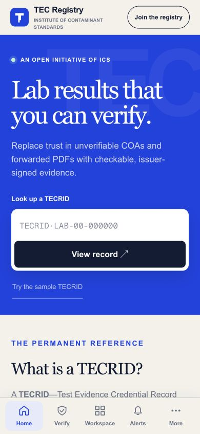
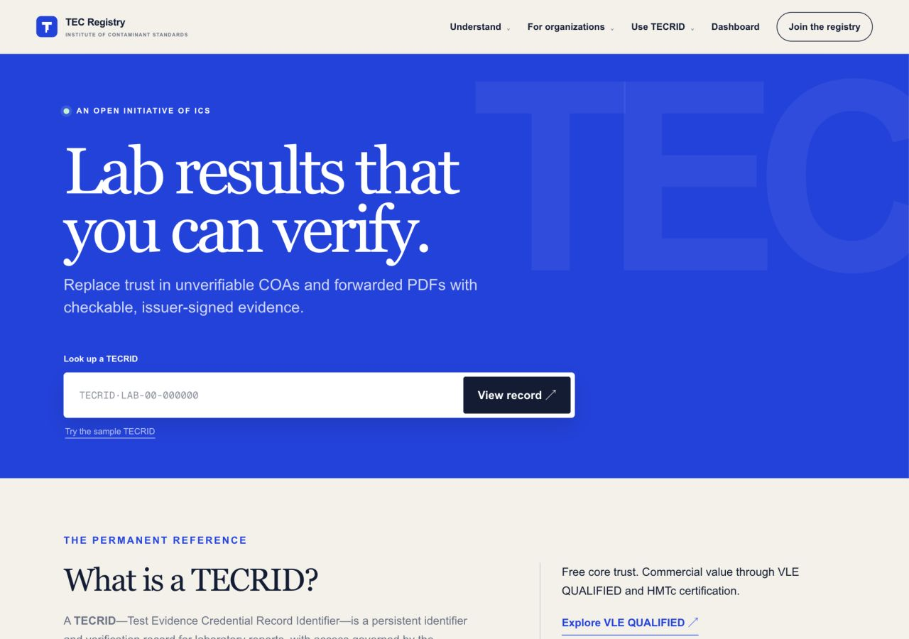

# TECRID live-fix and mobile source sync

This single PR extends the existing homepage PR #19. Its base is `origin/main` at `42c679d78130df53ed42121098b00a733b8ebab9`, including merged PR #17. It synchronizes the Oct 24 live presentation from Sites version 56, source `7f1817d61fd7ecee160e2c5be1333baf511d44ff`.

## Included mobile work

The current blue TECRID logo, favicon and Apple/app icon exports, home-screen manifest, safe-area viewport, 48px phone inputs, responsive report tables, fixed Home/Verify/Workspace/Alerts/More tabs, accessible More dismissal, workspace branding, grouped desktop navigation, and verification input settings are included. The content-sized homepage hero and following explanatory section are also included.

The existing live Alerts tab depends on the live inbox UI, authenticated feed, VLE bridge, per-recipient read markers and existing event inserts. Those dependencies are synchronized with their original tests and SQL migration. This restores the live inbox; it does not implement the later mint-to-phone outbox or send any notification. The existing live www-to-apex redirect and its four tests are included.

Main's newer self-referencing canonicals, permanent pricing redirect, Light Labs quick-start documentation and downloadable connector archives are retained. The older live copies would regress those fixes. Uncommitted experiments and duplicate ` 2`/` 3` source files in the original working folder are preserved locally and excluded from the PR.

## Preservation

The homepage resolver sample, proof-boundary section and following pilot section are byte-identical to main. Existing disclosure wording moves verbatim below the thin hero. The PR #17 card endpoint, card UI, sample reference, protected results, access-control library and their focused tests remain byte-identical to main. Its global digital-card styles are preserved; CSS differences from main concern only the homepage hero and explanatory section. The issuance test gains only an assertion for the existing live issuance notification.

`source-parity.json` contains exact hashes for imported live files and preserved PR #17 files, plus the deliberate main/live differences. No real result data or original PDFs are added. Screenshots show only the public homepage. The whole-folder backup is private and local; it is not included in GitHub.

## Validation

- Production build passed (`build.txt`).
- All 59 unit/backend tests across 17 files passed (`unit-tests.txt`), including protected results, digital cards, organization membership, personal read state, service authentication, routing permissions, mobile navigation and inbox UI.
- All 28 rendered/Worker checks passed (`rendered-tests.txt`): 24 rendered-page checks and four www redirect checks. The hero regression requires four children ending in the lookup, no trailing empty element, minimum height zero and the tighter spacing. It rejects anonymous Edit site text and control labels/titles/values.
- Fresh no-cookie public HTML returned 200 with zero Edit site matches (`anonymous-curl.json`).
- Live and local browser measurements match exactly at widths 320, 390, 767 and 1280 (`responsive-live.json`, `responsive-local.json`). All have zero horizontal overflow and no Edit site element. Phone hero bottom padding is 32px; desktop padding is 56px. The 1280px hero is 597.625px tall and ends at y=673.625.
- Local mobile More opens within the viewport, closes on Escape and restores focus. The sample lookup loads `TECRID·DEMO-26-HM0001` and resolves its explicitly fictional record without overflow.
- React component review and Git whitespace checks passed. Worker tests needed host-local networking because sandboxed local sockets were blocked; the successful run used isolated fixtures and mocked transports.

## Current screenshots

| Live mobile, 390px | Local mobile, 390px |
| --- | --- |
|  |  |

| Live desktop, 1280px | Local desktop, 1280px |
| --- | --- |
|  |  |

The local Node preview has no production notification bindings and can show its notification-unavailable bell; live anonymous visitors receive the normal signed-out feed. No permissions or live runtime settings were changed.

The older `tecrid-live-home-1280.png`, `tecrid-local-home-1280.jpg` and `tecrid-local-layout.json` remain as the earlier homepage-only verification record. The screenshots above verify the final mobile/logo sync.

PR only. No deployment, merge, production migration, real notification, or mint was performed. Await Elon verification before continuing TECRID-MINT-TO-PHONE-1. Its existing #18 will need to reconcile the live inbox/schema changes when rebased after this sync.
