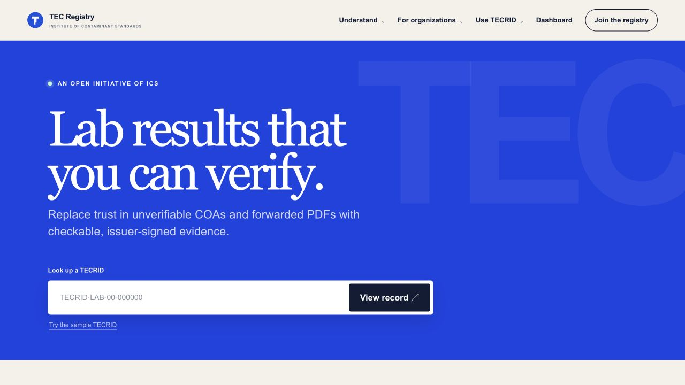

# TECRID homepage layout sync and live-fix verification

This PR synchronizes the live homepage layout into GitHub. `app/page.tsx` and `app/globals.css` are byte-identical to current live Site version 56. The resolver sample and proof-boundary section remain byte-identical to GitHub main, and the definition's disclosure wording moves below the hero verbatim.

The current anonymous public homepage was checked on October 25, 2026 with curl without cookies and a fresh browser tab at 1280 by 720 pixels.

## Current live findings

- The hero ends at approximately y=674 in the 720px screenshot. The next section begins within the first screen. The sample path is visible immediately beneath the lookup.
- No Edit site pill appears in the anonymous screenshot or accessibility tree. The no-cookie curl response has zero matches for Edit site. Signed-in editor visibility was not reproduced, so the evidence supports anonymous absence only. No editor behavior was changed.
- The screenshot and HTML observation are from https://tecrid.com/. The current live Site is version 56, source `7f1817d61fd7ecee160e2c5be1333baf511d44ff`, committed October 24 at 19:57:36 Asia/Nicosia and deployed successfully at 20:01:02, after the 19:38 report.

`anonymous-curl.json` records the no-cookie command, response SHA-256, byte count and editor-text check. The current response includes the sample path.

## Source comparison

GitHub main `42c679d78130df53ed42121098b00a733b8ebab9` has a different homepage implementation from the live Site. Its hero still contains the full definition, commercial links and principles rail. This PR adopts the live thin hero and moves that existing explanatory material below it.

The spacing rule on main is `.hero.sell-hero { padding-bottom: 100px; }`, while the current live source uses `.hero.sell-hero { min-height: 0; padding-bottom: 56px; }`. The more specific live selector prevents the later general `.hero` minimum heights from forcing extra space.

Files changed versus main:

- `app/page.tsx`: synchronize the live hero and following definition section, with the existing explanatory wording moved out of the hero. The resolver sample and proof-boundary sections are unchanged.
- `app/globals.css`: synchronize the live content-sized hero and responsive definition-section layout.
- `tests/rendered-html.test.mjs`: add the focused homepage regression.
- This verification directory: add the current live screenshot, curl evidence, source-parity hashes and passing output.

`source-parity.json` records the exact source commit and SHA-256 of the unchanged sample/proof-boundary block. No resolver, sample data, disclosure policy, proof-boundary wording, API, registry or mint behavior changes.

## Validation

The production build passed. `node --test tests/rendered-html.test.mjs` passed all 24 tests, including the new computed-style and anonymous-render regression. Exact output is in `rendered-tests.txt`.

The regression renders the actual built homepage, applies the real stylesheet in JSDOM, verifies that the hero has no forced minimum height and uses the tighter spacing, requires the lookup to be the final hero element with no empty trailing block, checks that the definition appears in the next section, retains lookup and sample controls, and rejects anonymous editor UI. JSDOM validates styles and markup; the live screenshot supplies the actual browser layout evidence.

Local browser QA at 1280 by 720 pixels matched the live view: hero bottom y=673.625, minimum height 0px, bottom padding 56px, four hero children ending with the lookup form, no horizontal overflow and no Edit site text. Exact measurements are in `tecrid-local-layout.json`.

No deployment or merge was performed.
