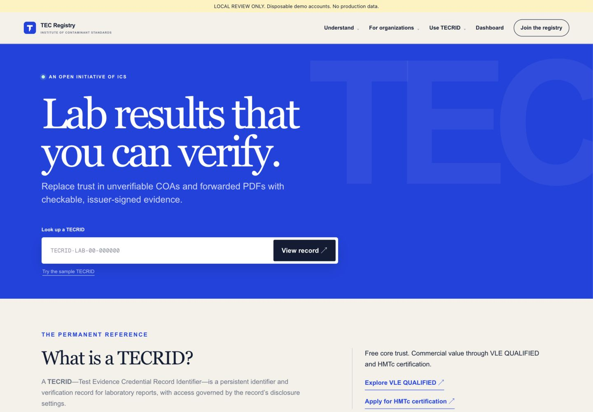
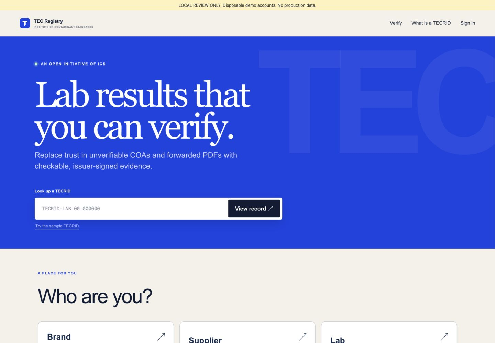
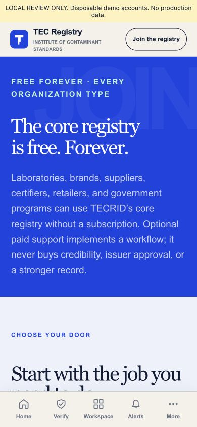
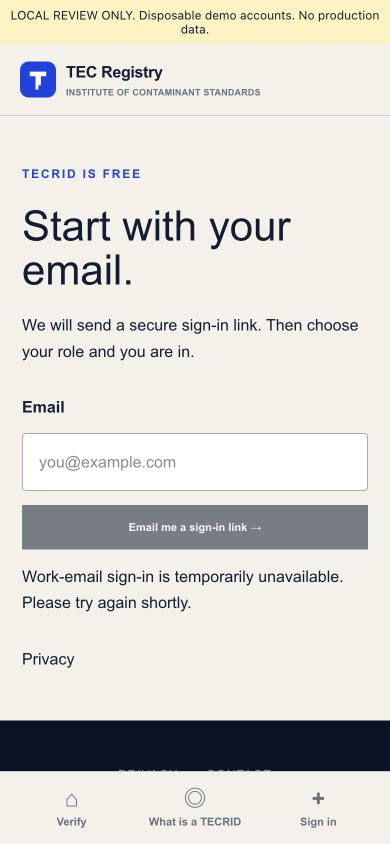
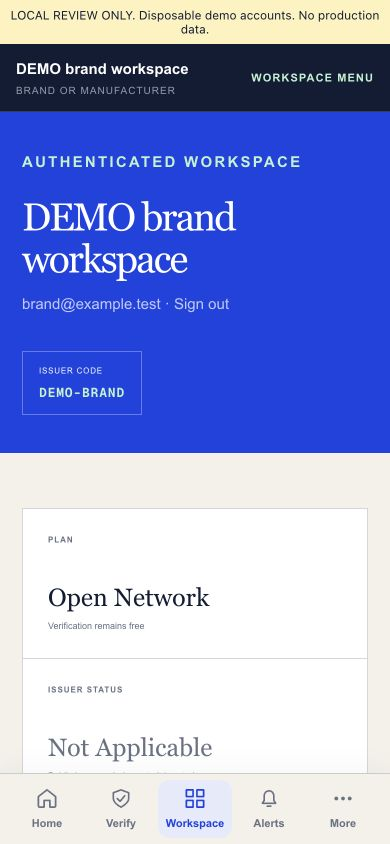
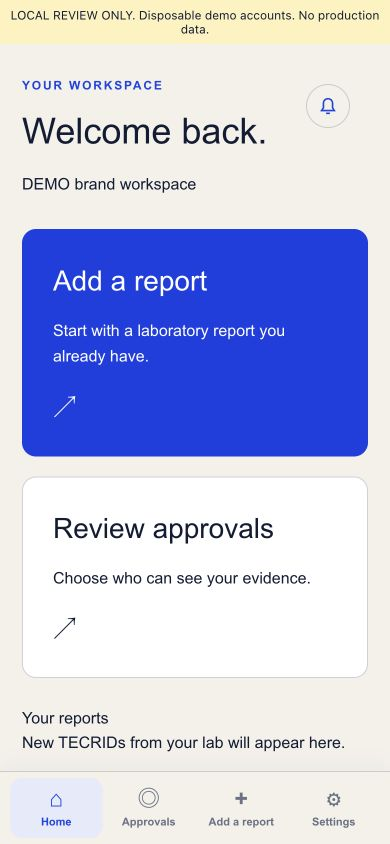

# THINK-SIMPLE-1: TECRID Part A

This is a separate, review-only change on the reviewed live-source sync from PR #19, commit `8336d36aaee6fcece56e8aafac40368317e75a41`. Its source tree is `065ebace3f8bebec9ef4487ae32dc93fda049509`, identical to the local sync baseline. No merge, deployment, production migration, notification send, or live issuance was performed. PR #18 and all VLE work are unchanged.

## Result

The first section after the unchanged thin lookup hero asks "Who are you?" Six large choices lead to a matching workspace. The validated anonymous preference survives navigation and email callbacks. After onboarding, the saved organization type determines the interface; a cookie cannot change membership, access, or issuer authority.

| Role | Items | Navigation |
| --- | --- | --- |
| Public | 3 | Verify, What is a TECRID, Sign in |
| Brand | 4 | Home, Approvals, Add a report, Settings |
| Supplier | 4 | Home, Approvals, Add a report, Settings |
| Lab | 4 | Home, Issue, Approvals, Settings |
| Certification body | 4 | Home, Requests, Received, Settings |
| Retailer | 4 | Home, Requests, Received, Settings |

A signed-in public account replaces Sign in with Settings, where it can sign out. Existing government organizations use the recipient interface; other legacy organization types fall back to the public interface without changing their stored type or privileges.

Desktop uses one role navigation. On a member dashboard, the public header is absent. At 390 pixels, only one bottom bar is visible. There is no More sheet or second phone workspace menu. The footer contains Privacy and Contact.

The dashboard presents one or two role actions and the current organization's existing records. Brand and supplier receipt identifiers link to the existing authorized receipt view. Notifications remain reachable from Home. Specialized existing workflows stay at their existing URLs. Approvals and Requests currently open the existing routing workflow, and Received opens the existing scoped sharing workflow. Consolidating approval systems is Part B, outside this PR.

## Signup and later details

Signup asks only for email. The existing verified, expiring magic-link authentication remains in place. The callback preserves both role and intended destination. After signing in, the role screen creates a workspace with that role alone. It does not fabricate a legal identity or grant authority.

Organization name and optional website are collected at the first report, request, lab-verification, or organization-settings step, then the user returns to the original destination. Completion is owner-only, same-origin, audited, and restricted to a provisional workspace. It cannot rename an established or verified organization. A new public account can use its account settings without organization details.

Lab review is a separate, four-step form: lab identity, accreditation, scope/contact, and signing/confirmation. Back preserves inputs; Continue validates the visible step; final submission validates every step. The original application payload and manual ICS approval service remain in place. Submitted applications show "We're verifying your lab, usually 1 business day". A pending lab can explore and prepare private drafts while production issuance remains locked.

## Removals

- Removed the $2,500 Founding Organization card, checkout link, and paid implementation comparison from `/join`.
- Removed both homepage occurrences of Explore VLE QUALIFIED and Apply for HMTc certification, including the secondary commercial value cards.
- Removed the broken `https://vle.exchange/for-suppliers` link from the front door and its shared value component.
- Removed the homepage audience pitch cards and pilot recruitment CTA; retained the fictional resolver sample and proof boundary verbatim.
- Removed dashboard plan/stat tiles, billing pitch, API key panel, and unrelated workflow cards from Overview. API management remains in Settings; established support workflows keep their URLs.
- Removed the public mega-nav, long footer, More sheet, and duplicate phone workspace menu.

## Validation

`npm test` passed: production build, 28 built Worker/rendered/redirect checks, and 72 unit/backend tests in 20 files. `test-results.txt` contains the output. Focused ESLint passed with no warnings or errors. Whitespace checks passed.

New tests cover all six role maps and bottom bars, active destinations, preserved signup role and return path for both new and already signed-in users, failed onboarding retry, member-role precedence, role-only durable onboarding, retry stability, owner-only deferred identity, invalid roles/websites, and the progressive lab form. Backend tests continue to reject issuance by unverified labs and preserve signature, disclosure, revocation, protected TEST card, and personal notification boundaries. Synthetic test-only issuance in the existing isolated backend suite does not touch the live registry.

The repository-wide TypeScript check is not clean at baseline: 64 errors before and 63 after, with no introduced error signatures. These include missing Cloudflare global types and existing test/crypto typing. See `typecheck-comparison.json` and the full before/after logs. This PR does not claim a clean repository-wide typecheck.

Browser checks used disposable local D1 accounts, visibly labeled DEMO. At 1440 and 390, every role rendered its intended navigation, with no horizontal overflow or public navigation on member dashboards. Phone tabs are 60 pixels tall; desktop role links are 50 pixels tall. `desktop-checks.json` and `phone-checks.json` record measurements. A fresh no-cookie curl returned 200 with zero Edit site matches; the rendered regression also checks anonymous control labels.

The browser exercised the actual local API flow: new Supplier choice, role-only onboarding, Home, Add a report, deferred organization details, owner-only save, and return to the original private intake page. It also followed Issue to the first small lab-verification step. The new role navigation uses ordinary links after browser testing exposed a client-router failure in the built Worker. No email, report, approval, or result was submitted through the browser.

`preservation.json` records byte-identical resolver sample, proof-boundary markup, and nine protected service/UI/schema surfaces. No schema migration is added. Source signatures, grant projection, protected TEST cards, result consent, and notification contents remain governed by their existing services.

## Review preview and screenshots

Local preview: `http://localhost:3110/?fixture=anonymous`. This is a loopback review server, not a deployed preview. Start it again with the README's disposable review-harness command if needed. For a role dashboard, open `/dashboard?fixture=brand` and substitute another role from the table.

All screenshots are actual browser captures. Each role and the public homepage/signup have before and after files at **1440 x 1000** and **390 x 844**. Baseline screenshots use the unchanged #19 source and disposable fixture accounts. The additional lab-setup image shows the four-step form's first step. No image is a number or stat card.

## The 12 year old test

Taps below count navigation and submit taps, not typing or opening the email app. No existing report is assumed for a new account.

For each organization role, the common landing-to-workspace path is: choose the role (1), enter email and send the link (2), open the email link (3), confirm the same role after sign-in (4). This is one tap after the email sign-in completes. Returning members skip the role screen and return directly to their original destination.

- Brand: common path, then tap an existing received TECRID on Home (5 total, 2 after sign-in). If none exists, the empty state says so. Add a report opens private intake; first use adds one organization-details Save tap, without claiming that upload creates a TECRID.
- Supplier: the same path and counts as Brand, with Supplier persisted independently.
- Lab: common path, tap Issue (5), then Continue lab verification (6). This reaches the first four-field step, with exploration available throughout. An approved lab can instead open Prepare a report. A draft is not a signed public TECRID.
- Certification body: common path, tap Requests (5) to reach the existing request workflow; enter the controlling organization's code and request details, then Send access request (6). First use adds one organization-details Save tap. Receiving results still requires the controlling organization to grant access.
- Retailer: the same path and counts as Certification body, with Retailer stored separately. Received opens the existing scoped sharing workflow in one tap from Home.
- Just looking: choose Just looking (1), enter an identifier and tap Verify (2). No signup is required. The explicitly fictional sample also works without an account. If this user signs up, email plus role selection leads directly to Verify; Settings is an account screen.

These paths are Part A review steps. Part C's broader screen-by-screen acceptance and the future unified approval list remain separate orders.
