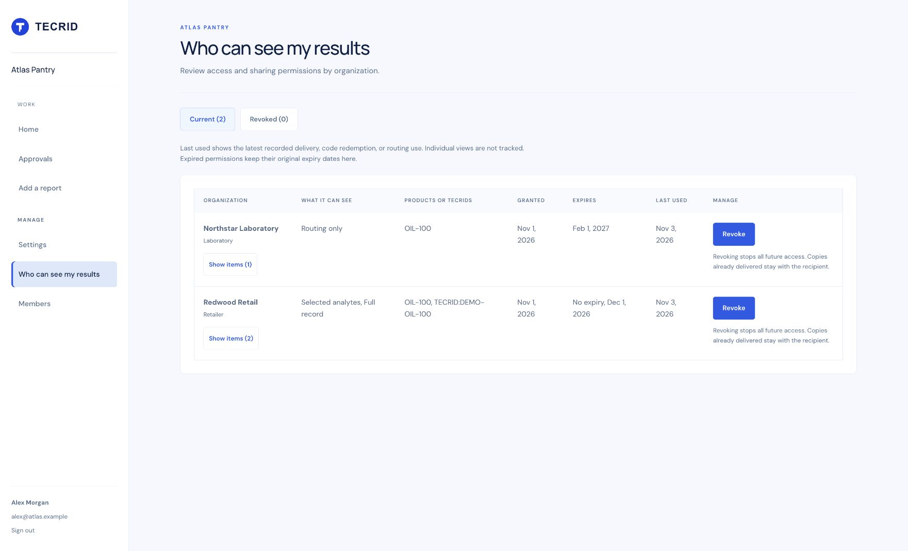

# Who can see my results

Adds `/dashboard/access` and a sidebar link for brand and supplier workspaces. The list groups existing evidence grants, active or redeemed share codes, and active routing authorizations by the receiving organization ID. Each item keeps its own scope, dates, and access level when expanded. No database migration is needed.

A routing authorization belongs to its laboratory and permits delivery. It does not grant that laboratory access to view the controller's results, so the list labels it `Routing only` rather than inventing an access level. Result permissions use `Status only`, `Selected analytes`, and `Full record`.

Last use is the latest recorded grant delivery, share-code redemption, or routing use. Individual page views are not tracked. Grants have no expiry field and show `No expiry`. An organization's granted date is its earliest current item's date; expiry dates and access levels are combined visibly, with item-specific values available when expanded. Records with an active or redeemed status remain listed even if their expiry date has passed.

Owners and Admins confirm before revoking all current items for an organization or one expanded item. The server selects targets within the current controller and calls the existing `revokeEvidenceGrant`, `revokeEvidenceShareCode`, and `revokeRoutingAuthorization` functions. Each function retains its audit trail and sends a recipient inbox notification. All three enforce manager permissions, including requests through the older grant revoke API. If any item fails, the UI refreshes and reports that remaining items still need revocation. Delivered records and redemption packages are retained.

Notifications do not include user-supplied package labels. This preserves the existing security check that revoked analyte details cannot surface in notification summaries. The Revoked view reads the three existing revocation event types from `audit_events` and resolves the organization and scope from their original permission records.

Validation on main at `daf3ce3`: `npm test` passes the production build, 35 rendered/redirect checks, and 134 unit/integration tests. New tests cover grouping, scopes, dates, use, single-item and whole-organization revocation, recipient notifications, retained copies, controller isolation, Member restrictions, confirmation, history, and sidebar visibility. Focused ESLint checks pass.

The screenshot uses synthetic Atlas Pantry data from `tests/support/workspace-access-fixture.mjs`. To reproduce it after building, run `WORKSPACE_ACCESS_PREVIEW=1 node --import ./tests/support/register-worker-env.mjs scripts/preview-workspace.mjs`. The loopback preview strips scripts and cannot forward writes or send email.

PR #60 was already merged before this addition was prepared. This local follow-up branch is ready for review. No deployment or production data change was performed.
