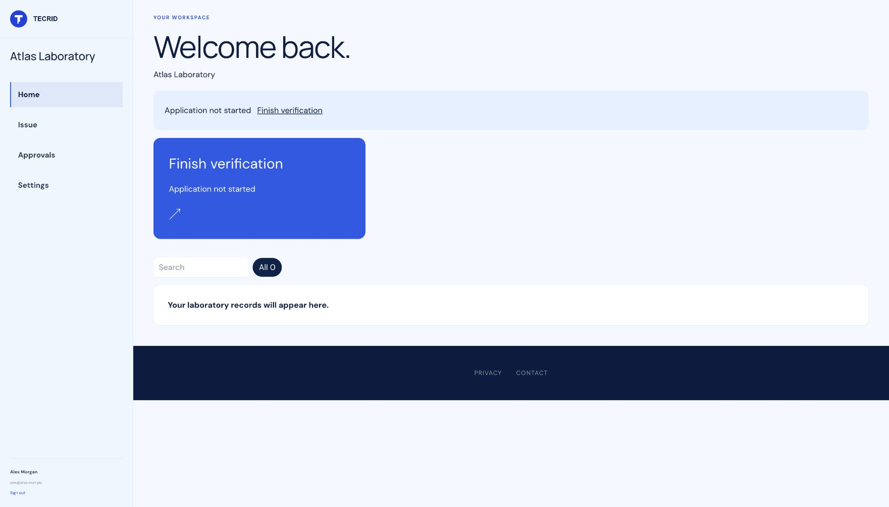
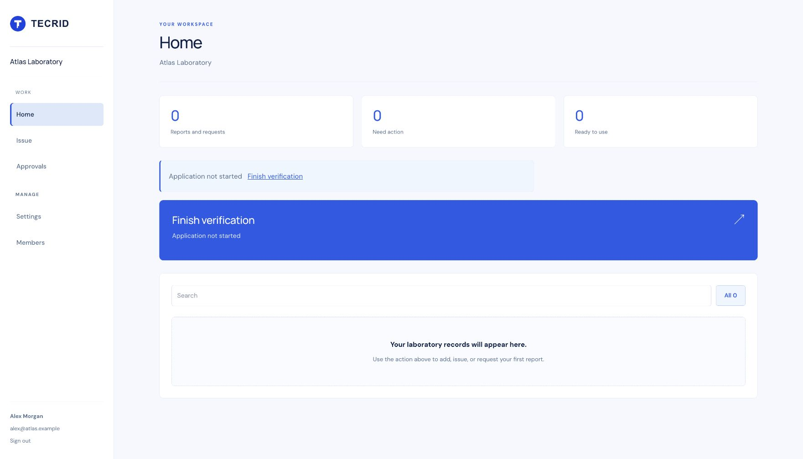
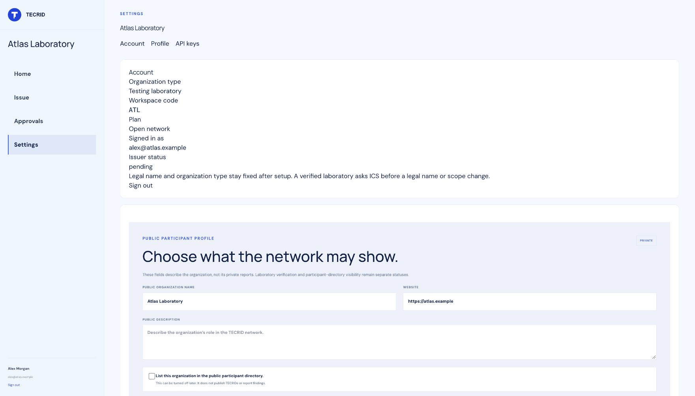
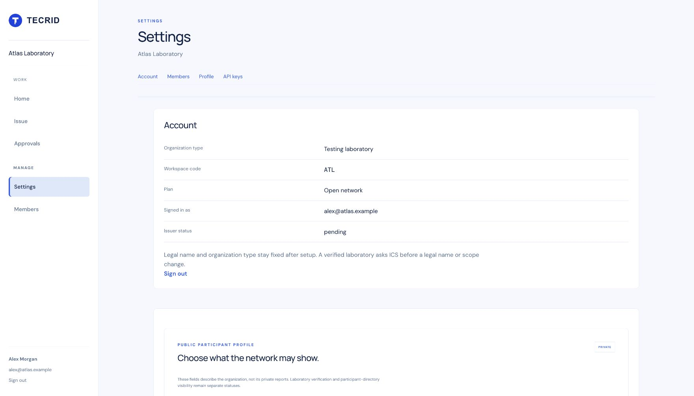
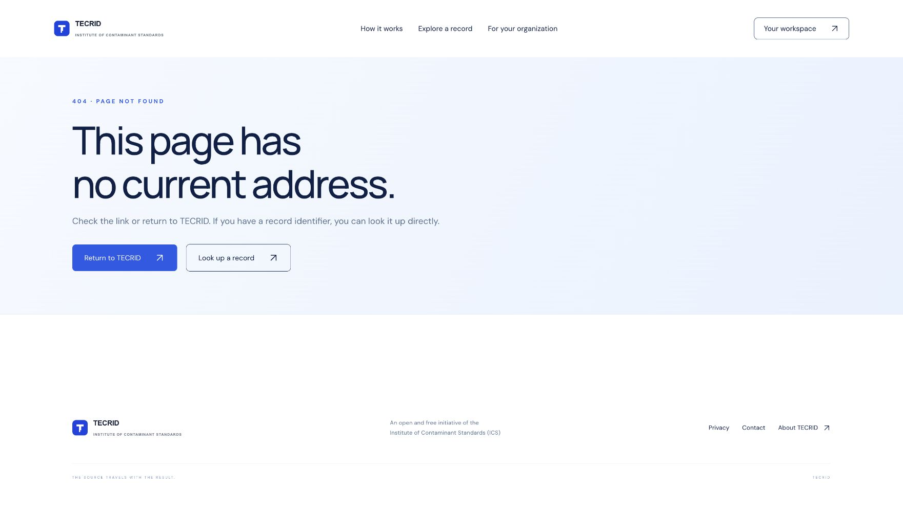
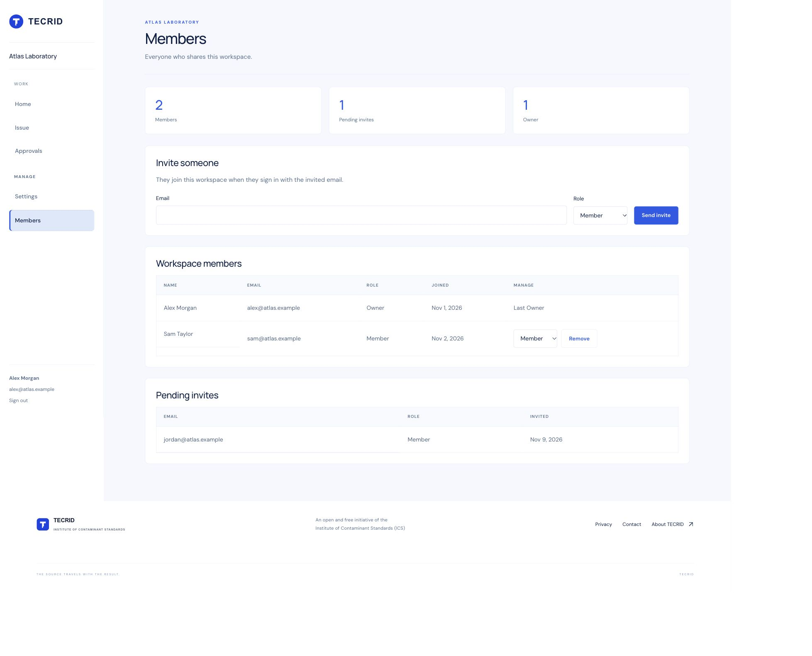
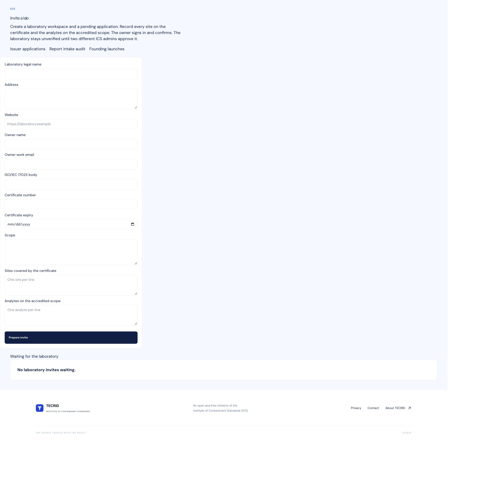
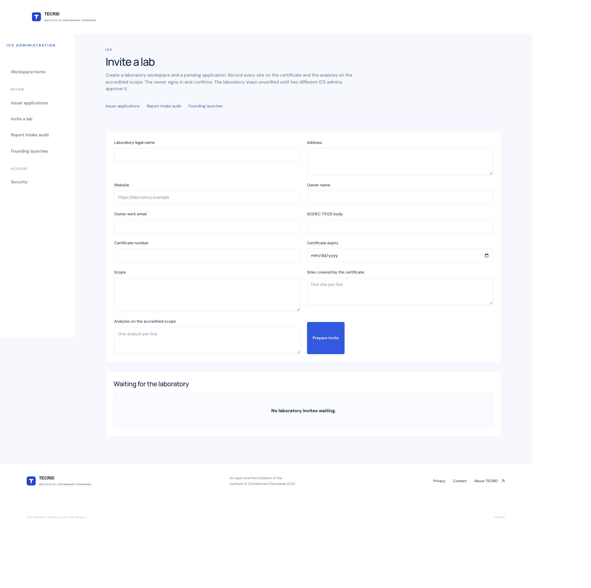

# Workspace members and Blue Atlas dashboard

The Members screen uses existing `organization_members` records. Migration `0024_workspace_members.sql` adds pending invitations, a display name on member records, and database guards for the last Owner and duplicate email membership. The existing `idx_members_user_id` stays intact. Apply this migration with the normal release migration process before running this code against a database.

Invites save first, then call the existing TECRID magic-link sender. Delivery failure leaves the invitation available for retry. A validated sign-in claims the invitation by email before workspace onboarding. Existing accounts stay in their current workspace. Member changes, audit events, and workspace inbox notifications commit together. The current Owner contact stays synchronized when ownership changes. Owner and Admin permissions are checked on the server. The original ICS review and second-factor guards remain in place.

The workspace and admin layouts use the Blue Atlas Shell from PR #58. The attached portal image supplied only usability ideas. All visual assets, typography, controls, and colors are TECRID's own.

## Screenshot evidence

Before captures use main at `68df9a9aeabc8089ffbac2cddb508bc4bf19ce2f`. After captures use this PR's tested source. Both use the same isolated, synthetic Atlas Laboratory fixture and browser viewport. The old Members URL returns 404 because the feature did not exist. Home and settings captures use the viewport; Members and admin invite captures show the full page where useful.

| Screen | Before | After |
| --- | --- | --- |
| Dashboard home |  |  |
| Settings |  |  |
| Members |  |  |
| Admin invite |  |  |

`tests/support/workspace-fixture.mjs` prepares synthetic data, a verified email session, and a local admin factor session. `scripts/preview-workspace.mjs` renders built pages on loopback only, strips scripts, and cannot send email or forward form writes. It is never imported by the application.

Validation: `npm test` passes the production build, 34 rendered and redirect checks, and 122 unit and integration tests. New coverage includes the Resend sender, automatic sign-in join, role authorization, cross-workspace conflicts, last Owner protection in the service and database, audit and inbox events, page rendering, sidebar navigation, and confirmation controls.

This PR is for Elon to review and merge. No deployment or production migration was performed.
